# United States Capitals Quiz Game

[uscapitalsquizgame.com](https://uscapitalsquizgame.com)

This is an application that allows a user to take multiple choice quizzes and save scores. One type of quiz is over capitals of states. The user is given a state and must guess the capital of that state. The other type of quiz is over states of capitals. The user is given a capital and must guess the state with that capital.

There are 3 versions of this app. 2 of them were made entirely by me: a Python command line version and a Java and Spring website version, which is the one that can be visited at [uscapitalsquizgame.com](https://uscapitalsquizgame.com). I used AI to make another Java and Spring website version. More info about that is in the ["AI Java and Spring Website Version" section](#ai-java-and-spring-website-version). There aren't many notable things to say about the Python version, so it's only talked about in the "Project History" section. The rest of this README, except for the 2 sections just mentioned, focuses on the Java and Spring version that I made myself.

<br/>

## Collapsible Sections

In case it's not obvious, the black triangles or play buttons below are where collapsible sections are and they can be expanded and collapsed by clicking on the triangle or to the right of it.

<br/>

## Website Overview for a User

<details>
<summary>Overview</summary>

### Home Page

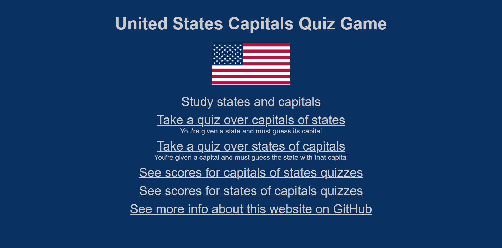

The background color is Old Glory Blue. As can be seen, that's the blue used on the American flag.

### Study States and Capitals

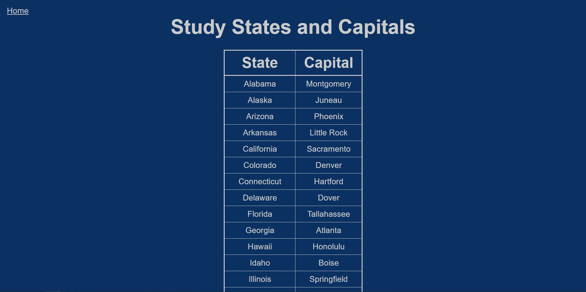

### Taking a Quiz

The quizzes have 10 questions. Each question is multiple choice and there are 5 choices, the last of which is "None of the above". There's approximately a 1 in 5 chance that the correct answer is "None of the above". After a choice is submitted and it's correct, the score will increment.

#### Capitals of States Quiz

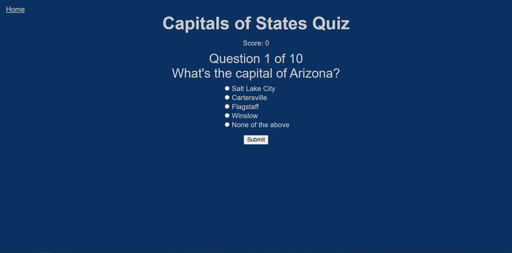

As can be seen in this screenshot, the question format is "What's the capital of \_?" 10 random states are generated for each quiz. These are the states that'll fill in that blank in the questions.

<details>
<summary>How answer choices are generated</summary>
<br/>

For each question, whether or not the correct answer is "None of the above", the answer choices will consist of a random non-capital city from the state that's in the question, a random non-capital city from a different random state, and a capital from a different random state. More info about non-capital cities can be found in the ["States and Cities"](#states-and-cities) -> "Non-Capital Cities" section. If the correct answer is **not** "None of the above", then the other answer choice will, of course, be the capital of the state in the question. If the correct answer is "None of the above", then the other answer choice will be a random non-capital city from the state in the question that's different from the first random non-capital city from that state. The choices will be in a random order.

</details>

#### States of Capitals Quiz

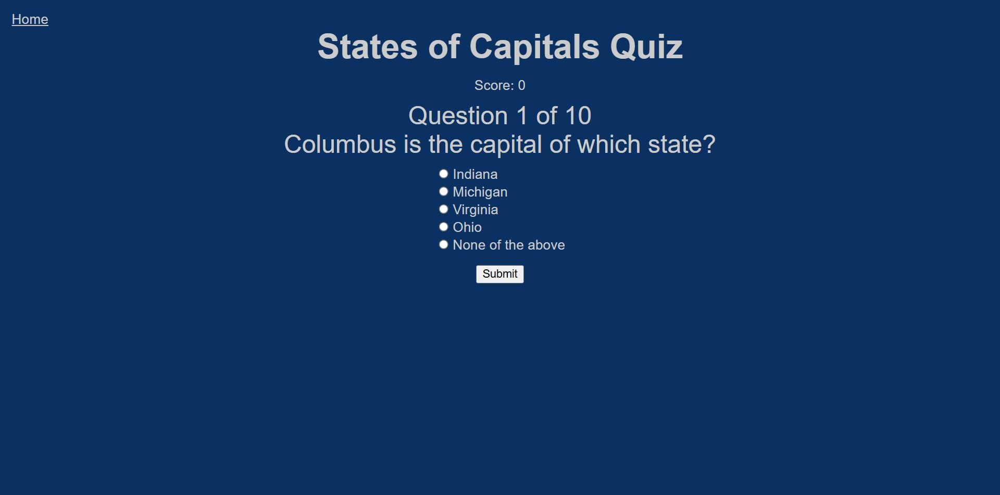

As can be seen in this screenshot, the question format is "\_ is the capital of what state?" 10 random capitals are generated for each quiz. These are the capitals that'll fill in that blank in the questions.

<details>
<summary>How answer choices are generated</summary>
<br/>

If the correct answer is **not** "None of the above", then the state whose capital is in the question will, of course, be one of the answer choices. The other choices will be 3 different random states. If the correct answer is "None of the above", then the answer choices will be 4 random states that are, of course, different from the state whose capital is in the question. The choices will be in a random order.

</details>

#### Quiz Over

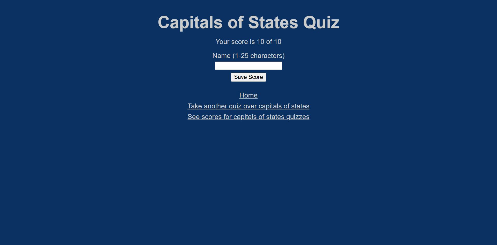

After entering a valid name and clicking "Submit":

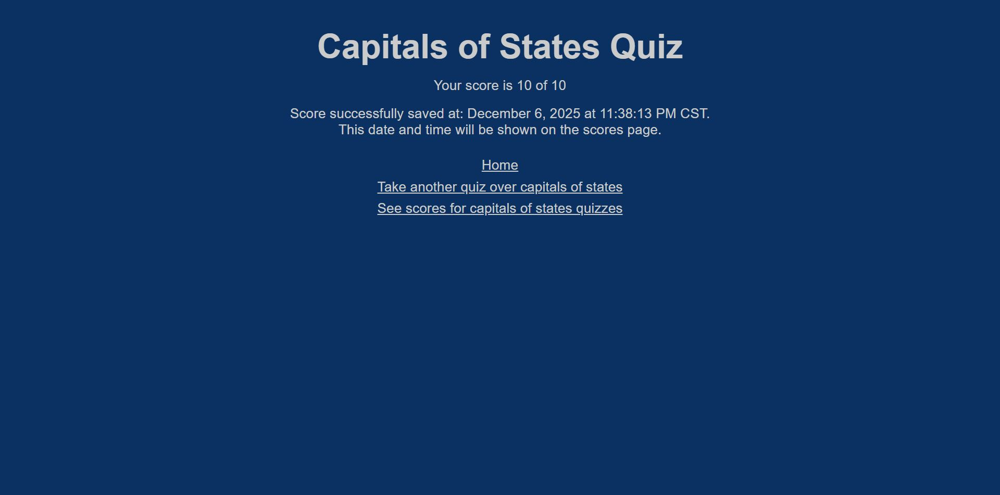

Note that leading and trailing whitespace will be ignored in the entered name.


### Seeing Scores

On the pages for seeing scores, a table like this gets shown:

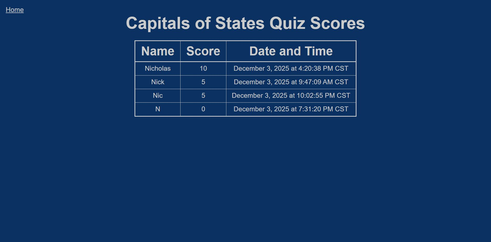

The rows are first ordered by score in descending order, so the highest score is at the top. Rows that have the same score are ordered by date and time in ascending order, so the score with the earliest date and time is the first.

The values for the date and time are based on the user's language and time zone. My language is English (United States) and my time zone is U.S. Central Time. At the time of this writing, it's November 2025 and the U.S. is using standard time so the offset for U.S. Central Time is UTC-6:00. The values in the screenshot above are based on those.

If I change the display language for my browser to Spanish (Spain); change the time zone on my computer to UTC+1:00, the time zone for Madrid, Spain; and go to the same scores page, this is what gets shown:

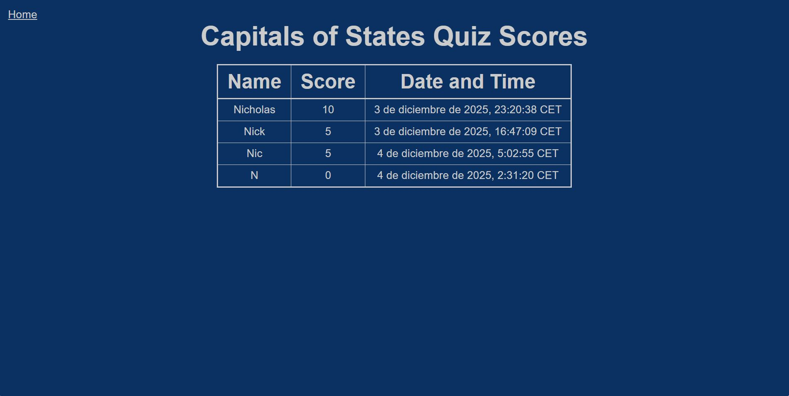

CET stands for Central European Time, which is even used by the western European country of Spain.

<details>
<summary>Why aren't initials that stand for something in Spanish being used?</summary>
<br/>

First, I didn't decide how the date and time values get shown. I used a tool that does that. See the ["Some Design and Implementation Info"](#some-design-and-implementation-info) -> "Visiting a Scores Page" section for more info on that.

I went to the [Wikipedia article for Central European Time](https://en.wikipedia.org/wiki/Central_European_Time) and then [changed the language for that article to Spanish](https://es.wikipedia.org/wiki/Hora_central_europea) and the beginning of that article is "Hora central europea u hora de Europa Central (HEC) o CET (Central European Time)." Apparently in Spain, the initials for Central European Time are either HEC or CET.

</details>

<br/>
</details>
<br/>

## States and Cities

This section doesn't have any design or implementation info about states data but the ["Some Design and Implementation Info"](#some-design-and-implementation-info) -> "States Data" section has that.

<details>
<summary>Info</summary>

### Non-Capital Cities

There's a collection of non-capital cities that are used as possible answer choices for capitals of states quiz questions. This collection contains 5 cities per state for a total of 50 × 5 = 250 cities. The cities from each state have various population sizes and one of them has a funny or silly name. Some examples of funny or silly city names are Parachute, Colorado; Waterproof, Louisiana; Dummer, New Hampshire; Okay, Oklahoma; and Jot-Em-Down, Texas.

There are 2 duplicate cities:
- Columbia, the capital of South Carolina and a populous city in central Missouri.
- Portland, the most populous city, but not the capital, in Maine and Oregon.

Capitals of states quiz questions should never have one of these cities be two answer choices.

### All States and Cities

In this table, there are 2 links to music videos on YouTube. The Markdown for the rows of this table was generated by the [admin page](#admin-page-and-api).

<details>
<summary>Table</summary>
<br/>

| State | Capital | Non-Capital Cities |
| :---: | :-----: | ------------------ |
| Alabama | Montgomery | Birmingham, Scratch Ankle, Selma, Talladega, Tuscaloosa |
| Alaska | Juneau | Anchorage, Dillingham, Fairbanks, North Pole, Sitka |
| Arizona | Phoenix | Flagstaff, Mesa, Tucson, Why, [Winslow](https://www.youtube.com/watch?v=5igDtWadYms&t=60s) |
| Arkansas | Little Rock | Conway, Fayetteville, Harrison, Springdale, Toad Suck |
| California | Sacramento | Bakersfield, Los Angeles, Redding, Rough and Ready, San Bernardino |
| Colorado | Denver | Boulder, Colorado Springs, Grand Junction, Greeley, Parachute |
| Connecticut | Hartford | Fairfield, New Hartford, New Haven, Waterbury, Windsor |
| Delaware | Dover | Delaware City, Middletown, Milford, Red Lion, Wilmington |
| Florida | Tallahassee | Jacksonville, [Kissimmee](https://www.youtube.com/watch?v=Jnq9wPDoDKg), Miami, Orlando, St. Augustine |
| Georgia | Atlanta | Athens, Augusta, Between, Cartersville, Macon |
| Hawaii | Honolulu | Hilo, Kailua, Lahaina, Princeville, Volcano |
| Idaho | Boise | Challis, Headquarters, Nampa, Pocatello, Twin Falls |
| Illinois | Springfield | Bloomington, Carbondale, Chicago, Metropolis, Peoria |
| Indiana | Indianapolis | Evansville, Fort Wayne, Gary, Santa Claus, Wabash |
| Iowa | Des Moines | Cedar Rapids, Centerville, Iowa City, Waterloo, What Cheer |
| Kansas | Topeka | Dodge City, Home, Lawrence, Lenexa, Wichita |
| Kentucky | Frankfort | Lexington, Louisville, Monkey's Eyebrow, Nicholasville, Paducah |
| Louisiana | Baton Rouge | Alexandria, Lafayette, Metairie, New Orleans, Waterproof |
| Maine | Augusta | Cape Elizabeth, Portland, Presque Isle, St. Albans, Strong |
| Maryland | Annapolis | Baltimore, Frederick, Halfway, St. Michaels, Towson |
| Massachusetts | Boston | Amherst, Cambridge, Middleborough, Sandwich, Springfield |
| Michigan | Lansing | Ann Arbor, Detroit, Free Soil, Grand Rapids, Saginaw |
| Minnesota | St. Paul | Duluth, Little Canada, Mankato, Minneapolis, St. Cloud |
| Mississippi | Jackson | Askew, Biloxi, Hattiesburg, Starkville, Vicksburg |
| Missouri | Jefferson City | Columbia, Fair Play, Sedalia, St. Charles, St. Louis |
| Montana | Helena | Billings, Circle, Fort Benton, Kalispell, Missoula |
| Nebraska | Lincoln | Bellevue, Kearney, Omaha, Scottsbluff, Worms |
| Nevada | Carson City | Henderson, Jackpot, Las Vegas, Rachel, Reno |
| New Hampshire | Concord | Claremont, Dummer, Manchester, Peterborough, Portsmouth |
| New Jersey | Trenton | Atlantic City, Camden, Elizabeth, Foul Rift, Newark |
| New Mexico | Santa Fe | Albuquerque, Las Cruces, Roswell, Thoreau, Truth or Consequences |
| New York | Albany | Buffalo, Fine, Ithaca, New York City, White Plains |
| North Carolina | Raleigh | Asheville, Charlotte, Durham, Kitty Hawk, Whynot |
| North Dakota | Bismarck | Cannon Ball, Dickinson, Fargo, Grand Forks, Mandan |
| Ohio | Columbus | Cincinnati, Cleveland, Mansfield, Mentor-On-The-Lake, Toledo |
| Oklahoma | Oklahoma City | Norman, Okay, Stillwater, Tulsa, Weatherford |
| Oregon | Salem | Bend, Boring, Corvallis, Medford, Portland |
| Pennsylvania | Harrisburg | Allentown, King of Prussia, Philadelphia, Pittsburgh, York |
| Rhode Island | Providence | Exeter, Newport, Pawtucket, Smithfield, Woonsocket |
| South Carolina | Columbia | Charleston, Due West, Florence, Greenville, Myrtle Beach |
| South Dakota | Pierre | Camp Crook, Chamberlain, Pine Ridge, Rapid City, Sioux Falls |
| Tennessee | Nashville | Clarksville, Knoxville, Memphis, Murfreesboro, Smartt |
| Texas | Austin | Abilene, Dallas, Houston, Jot-Em-Down, New Braunfels |
| Utah | Salt Lake City | Dutch John, Ogden, Provo, Richfield, St. George |
| Vermont | Montpelier | Barton, Bennington, Burlington, Essex, Middlesex |
| Virginia | Richmond | Arlington, Charlottesville, Fries, Norfolk, Roanoke |
| Washington | Olympia | Bellingham, Seattle, Soap Lake, Spokane, Tacoma |
| West Virginia | Charleston | Cheat Lake, Huntington, Morgantown, Parkersburg, Summersville |
| Wisconsin | Madison | Chili, Green Bay, La Crosse, Milwaukee, Wausau |
| Wyoming | Cheyenne | Casper, Jackson, Sheridan, Spotted Horse, Thermopolis |

</details>
<br/>
</details>
<br/>


## Admin Page and API

<details>
<summary>Info</summary>
<br/>

The link for the admin page is [uscapitalsquizgame.com/admin](https://uscapitalsquizgame.com/admin) or [that link followed by `.html`](https://uscapitalsquizgame.com/admin.html). You have to log in to get the response of any HTTP request to an endpoint that starts with `uscapitalsquizgame.com/admin`. If you make an HTTP request to one of those endpoints without being logged in, the server will respond with HTML for the login page. If you try going to the admin page in a browser, that HTML will be shown:

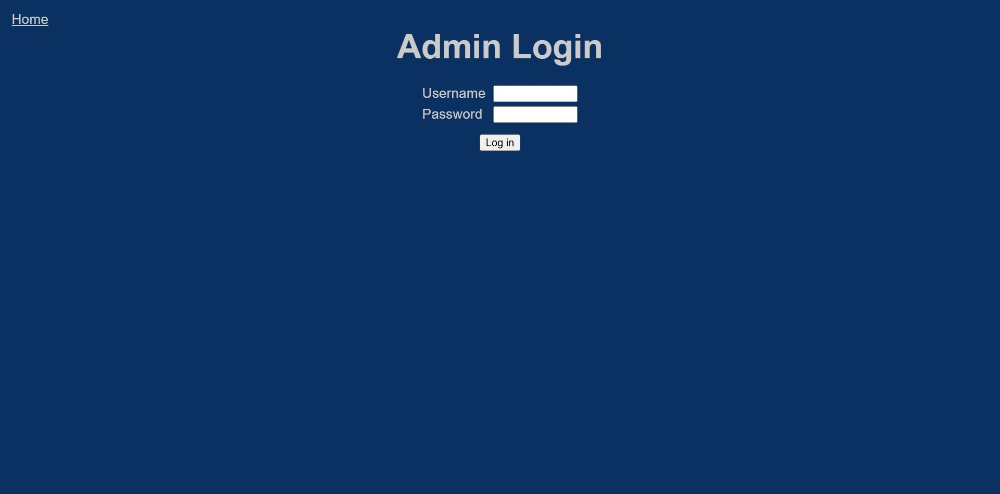

<details>
<summary>Password Info</summary>
<br/>

There's one set of admin credentials and the password for it was hashed with [Bcrypt](https://en.wikipedia.org/wiki/Bcrypt), so if you look at the source code for the credentials in [`AdminSecurityConfiguration.java`](https://github.com/ncschroeder/US-Capitals-Quiz-Game/blob/main/Java_and_Spring_Version/src/main/java/com/uscapitalsquizgame/admin/AdminSecurityConfiguration.java), you'll see this:

```java
UserDetails admin =
    User.withUsername("admin")
    .password("{bcrypt}$2a$10$ZJ9pQ1bTRzNhuWQ2UwxxL.lirdtUfS/8krzVHeS9UrmSxfvEPFN5K")
    ...
```

Currently, in order for me to change this password, I'll have to generate a hash for a new password, put that in the source code, create a new `jar` file for the app, create a new container image using that `jar`, upload that image to Docker Hub, and make the Azure container app use the new image. Optionally, I could push the source code change to GitHub and delete the old image.

</details>

After logging in, this is the admin page:

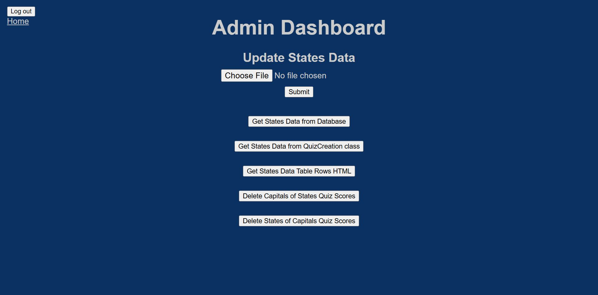

### Updating States and Cities

<details>
<summary>Info</summary>
<br/>

The states and cities used for quizzes are updated via the admin page. This is the only feature of the website that has unit testing. A file containing state and city names separated by commas must be submitted. Each line in the file should contain values for a state name, that state's capital, and non-capital cities in that state. The file I used, [states_and_cities.txt](https://github.com/ncschroeder/US-Capitals-Quiz-Game/blob/main/Java_and_Spring_Version/states_and_cities.txt) is in the `Java_and_Spring_Version` folder and here are the first 5 lines of it:

```
Alaska,Juneau,Anchorage,North Pole,Fairbanks,Sitka,Dillingham
Hawaii,Honolulu,Hilo,Volcano,Kailua,Princeville,Lahaina
California,Sacramento,Rough and Ready,Los Angeles,Bakersfield,Redding,San Bernardino
Nevada,Carson City,Jackpot,Las Vegas,Reno,Henderson,Rachel
Oregon,Salem,Boring,Portland,Bend,Corvallis,Medford
```

I decided to have that file be a plain text file and have the file input HTML element accept only plain text files because I put `states_and_cities.txt` and some files used for testing this feature on GitHub, and GitHub displays `csv` files as a table with the first row of the file as a headings row of the table. This is documented [here](https://docs.github.com/en/repositories/working-with-files/using-files/working-with-non-code-files#rendering-csv-and-tsv-data). I don't want that so I'm just using plain text files that have comma-separated values.

There are some rules that must be followed for states and cities to get updated:

- The file must be no bigger than 10 KB.
- The 1<sup>st</sup> line must contain at least 4 values.
- All the other lines must contain the same amount of values as the 1<sup>st</sup> line.
- There must be no blank values, duplicate state names, nor duplicate non-capital cities for the same state.

There's no checking for how many lines/states are in the file. It's possible that Washington D.C. and Puerto Rico could become states in the future so it seems forward-thinking of me to not require there to be 50 states in the file. To make it clear how many states were in the file, a message will be shown after updating and this can be seen in the image below.

If all goes well, state names and cities will have leading and trailing whitespace removed and internal whitespace replaced by a single space. The `state` and `city` tables in the database will be cleared. States and their capitals will be added to the `state` table in alphabetical order by state. Non-capital cities will be added to the `city` table in alphabetical order after their state is added to the `state` table. The states data used by the `QuizCreation` class will be updated. More info about states data and the `QuizCreation` class can be found in the ["Some Design and Implementation Info"](#some-design-and-implementation-info) -> "States Data" section.

Message after updating:

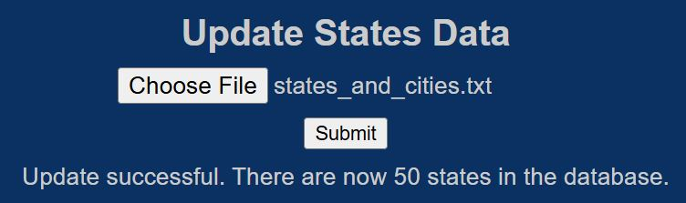

<br/>
</details>

### Getting States Data

Getting states data from the database or `QuizCreation` class will result in a table being shown like this:

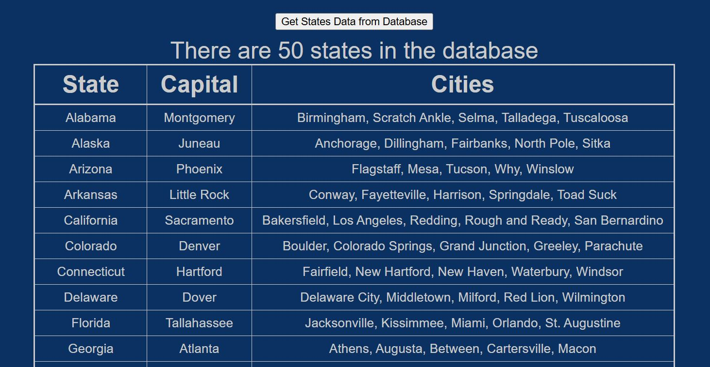

Getting states data table rows Markdown will result in this being shown:

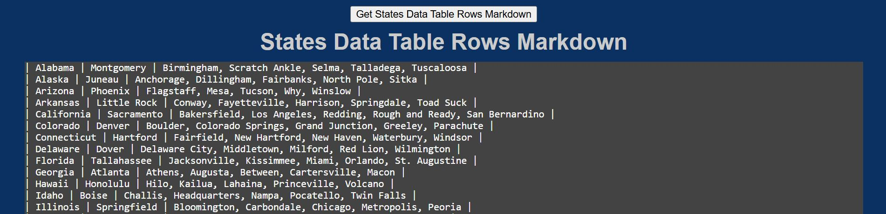

This is how the Markdown used for the table in the ["States and Cities"](#states-and-cities) -> "All States and Cities" section was generated.

### Deleting Scores

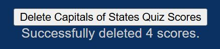

<br/>
</details>
<br/>


## Deployment to the Internet

I'm using [Microsoft Azure Container Apps](https://learn.microsoft.com/en-us/azure/container-apps/overview) to have this app be on the internet and I'm using GoDaddy as my registrar for the domain `uscapitalsquizgame.com`. I created a container image for this app by first creating a `jar` file and then using the Docker CLI and a `Dockerfile` in the `Java_and_Spring_Version` directory with this code:

```dockerfile
FROM mcr.microsoft.com/openjdk/jdk:21-mariner
COPY target/us-capitals-quiz-game-1.jar app.jar
ENTRYPOINT ["java", "-jar", "/app.jar"]
```

I then pushed my image to this [repository of mine on Docker Hub](https://hub.docker.com/repository/docker/nschroeder131/us-capitals-quiz-game/general). The container app pulls the image from this repo.

<details>
<summary>Info about <code>mcr.microsoft.com/openjdk/jdk:21-mariner</code></summary>
<br/>

This is a container image for the [Microsoft Build of OpenJDK](https://learn.microsoft.com/en-us/java/openjdk/overview) for Java 21 for [Mariner, AKA Azure Linux](https://learn.microsoft.com/en-us/azure/azure-linux/faq). I decided to use this JDK image as my base image simply because there's a [sample app for Azure Container Apps](https://github.com/Azure-Samples/containerapps-albumapi-java) that uses it as its base image and the [plain OpenJDK Docker image](https://hub.docker.com/_/openjdk) is deprecated.

</details>
<br/>


## Some Design and Implementation Info

<details>
<summary>Info</summary>


### Views

The home, study, admin, and error pages use static HTML. The quiz, scores, and admin login pages use the template engine [Apache FreeMarker](https://freemarker.apache.org/index.html). The template engine [Thymeleaf](https://www.thymeleaf.org/) seems to be more popular for Spring applications but I chose FreeMarker since it seemed to be much simpler and Spring has built-in support for it along with Thymeleaf and a few other template engines.

The quiz and scores pages have scripts that use data from the server. This is implemented by having the server render this data as JSON inside a `<script>` element and then having the other script parse that JSON.

The [error page](https://www.uscapitalsquizgame.com/error.html) gets shown when an unexpected error happens when trying to show another view. I consider this to be pretty unlikely so the error page just has a "United States Capitals Quiz Game" heading, a message that just says "Error", and a link to the home page.


### Database Service Used: [Microsoft Azure Database for MySQL](https://learn.microsoft.com/en-us/azure/mysql/).


### States Data

There are 2 database tables, `state` and `city`, and 1 Java class, [`State`](https://github.com/ncschroeder/US-Capitals-Quiz-Game/blob/main/Java_and_Spring_Version/src/main/java/com/uscapitalsquizgame/states/State.java), for states data. There's also the Java interface [`StateRepository`](https://github.com/ncschroeder/US-Capitals-Quiz-Game/blob/main/Java_and_Spring_Version/src/main/java/com/uscapitalsquizgame/states/StateRepository.java).


#### `state` Columns
- `id` (`SMALLINT UNSIGNED NOT NULL`)
- `name` (`VARCHAR(30) NOT NULL`)
- `capital` (`VARCHAR(30) NOT NULL`)

#### `city` Columns
- `id` (`SMALLINT UNSIGNED NOT NULL`)
- `state_id` (`SMALLINT UNSIGNED NOT NULL`)
- `name` (`VARCHAR(30) NOT NULL`)

The `state_id` column of `city` is a foreign key that references the `id` column of `state` with cascading on delete.


#### `State` Fields
- `id` (`Integer`)
- `name` (`String`)
- `capital` (`String`)
- `cities` (`List<String>`)

Here's the code for the `cities` field:

```java
@ElementCollection(targetClass = String.class, fetch = FetchType.EAGER)
@CollectionTable(name = "city", joinColumns = @JoinColumn(name = "state_id"))
@Column(name = "name")
private List<String> cities;
```


The ["Admin Page and API"](#admin-page-and-api) -> "Updating States and Cities" section mentioned some info about how the `state` and `city` database tables and the `QuizCreation` class get updated. The `QuizCreation` class is what's used to generate questions and answer choices for quizzes. One of its fields is `ArrayList<State> states` and this is where the states data is for generating questions and answer choices. The `updateStates` method of the `AdminRestController` updates the database tables and calls `QuizCreation.setStates`, which then accesses the states data in the database and puts it into the `states` list. It seems like a good idea to have this data be in a list because accessing data from a list lots of times when a user wants to take a quiz is probably a lot quicker than querying the database lots of times. The states data is in the database in addition to being in a list in case the server restarts for some reason. The `QuizCreation` class has a `CommandLineRunner` bean which makes the `states` list get filled with data from the database when the server is started.


### Scores

After a quiz, a user has the option to enter a name and submit their score. To store score data, there's a `score_data` table in the database and the corresponding Java class is `ScoreData`.

#### `score_data` Columns
- `id` (`SMALLINT UNSIGNED NOT NULL`)
- `score` (`TINYINT UNSIGNED NOT NULL`)
- `name` (`VARCHAR(25) NOT NULL`)
- `quiz_type` (`VARCHAR(30) NOT NULL`)
- `save_date_time` (`DATETIME NOT NULL`)

#### `ScoreData` Fields
- `id` (`Integer`)
- `score` (`int`)
- `name` (`String`)
- `quizType` (`String`)
- `saveDateTime` (`OffsetDateTime`)

#### Submitting a Score

When enters a name and tries to submit their score, the name will have its leading and trailing whitespace removed and then its length will be checked. If it's > 0 and ≤ 25, then the name and score will be sent from the front end to the back end. Each quiz type has an endpoint for adding a score. There's some back-end validation for the name and score but these should pass if the front-end validation passed. The back-end name validation is the same as on the front end. The score is validated to be ≥ 0 and ≤ 10, the number of quiz questions. The score that gets sent to the back end should be in that range. A `ScoreData` gets created and a row gets added to the `score_data` table based on that. The `quizType` of the `ScoreData` is the return value of the `getQuizTypeDbColValue` of the appropriate `QuizManager`. The `saveDateTime` of the `ScoreData` is the UTC time when the request was made. UTC time doesn't have to be used. Any time offset can be used but I decided to use UTC time.

#### Visiting a Scores Page

There's a scores page for each quiz type. When one of the scores pages is visited, the server uses the `getQuizTypeDbColValue` method of the appropriate `QuizManager` to get rows of the `score_data` table with the appropriate quiz type and puts the data into `ScoreData` objects. The `name` and `score` fields of these are rendered into an HTML table in an HTML document on the server. I'm going to use the term *epoch milliseconds* to refer to the number of milliseconds since the Unix epoch, which is midnight in UTC time on January 1<sup>st</sup>, 1970. The server gets the epoch milliseconds of the `saveDateTime` fields of the `ScoreData`s and puts these into a script on the same HTML document. This HTML document gets sent to the front end and then a different script for this HTML document has JavaScript that accesses the epoch milliseconds and creates date and time strings that are based on the user's language and time zone. These strings are created by using the `format` method of an [`Intl.DateTimeFormat`](https://developer.mozilla.org/en-US/docs/Web/JavaScript/Reference/Global_Objects/Intl/DateTimeFormat). This `Intl.DateTimeFormat` is the tool I was referring to in the collapsible section of the ["Website Overview for a User"](#website-overview-for-a-user) -> "Seeing Scores" section.


### How to update this app if a state or states get added or removed

The home page has a link to the GitHub repo and in this README is the table of all states and cities, so that should be updated.

The study states and capitals page uses static HTML. The process for updating that is almost the same as the process for changing the admin password: I would have to update the HTML file, create a new `jar` file for the app, create a new container image using that `jar`, upload that image to Docker Hub, and make the Azure container app use the new image. Optionally, I could push the source code change to GitHub and delete the old image.

As mentioned in the ["Admin Page and API"](#admin-page-and-api) -> "Updating States and Cities" section, to update states and cities, there doesn't have to be 50 states in the file that gets uploaded, so a state or states can be added or removed by just updating the file used and uploading that file. 

<br/>
</details>
<br/>

## AI Java and Spring Website Version

I used Claude to make another Java and Spring version and a couple JUnit tests for it. I had it generate most of the code and documentation.

<details>
<summary>Screenshots</summary>
<br/>

Home page

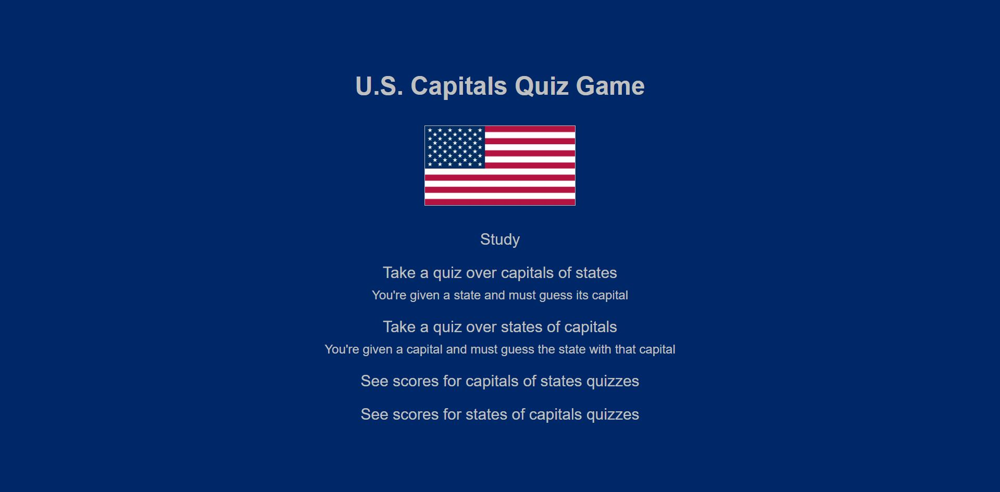

Study page

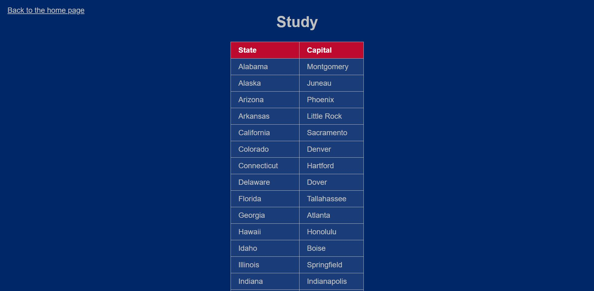

Capitals of states quiz question

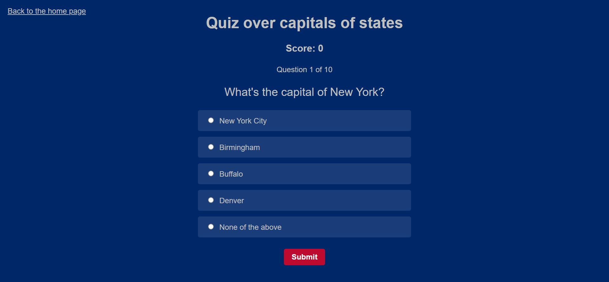

States of capitals quiz question

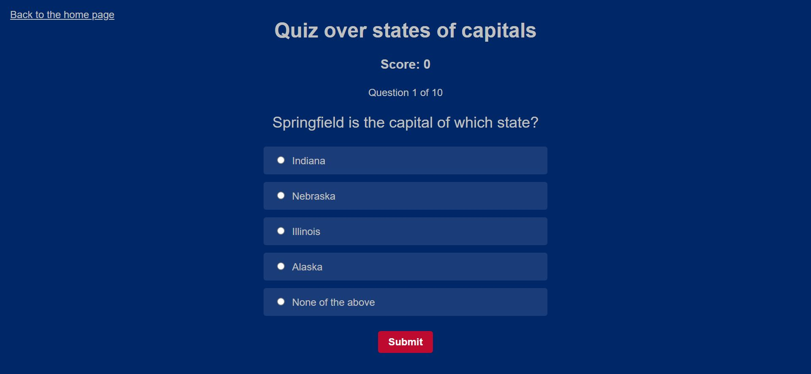

Quiz over content


Scores page


Admin login page


Admin page

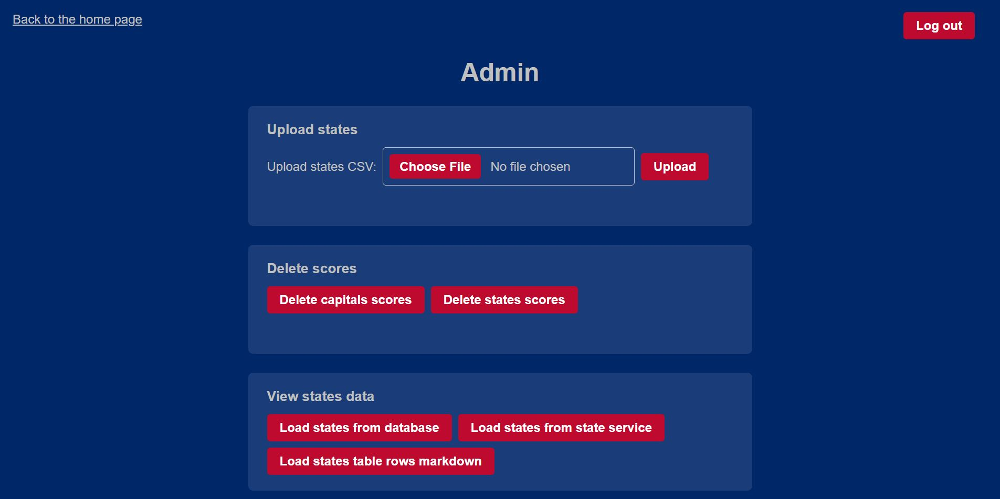

</details>

I also had Claude create a states and cities file, the same kind mentioned in the ["Admin Page and API"](#admin-page-and-api) -> "Updating States and Cities" section. The prompt I used was `create some csv data for states that can be uploaded to the state service. for each state, choose 5 cities that have various population sizes and have 1 of these cities be one with a funny or silly name`. Many of the funny names it generated are ones that I used. My favorite one Claude came up with is Knockemstiff, Ohio. This [states and cities file](https://github.com/ncschroeder/US-Capitals-Quiz-Game/blob/main/AI_Java_and_Spring_Version/states_and_cities.txt) is in the AI version folder.

I also asked Claude about some ideas for a favicon and it came up with 7, including the one I used for the version I made myself, which is just the text "US" on a color background. For this version, I ended up picking a white star on a blue background. Claude made an [SVG file for it](https://github.com/ncschroeder/US-Capitals-Quiz-Game/blob/main/AI_Java_and_Spring_Version/src/main/resources/static/favicon.svg).

<br/>


## Project History

I think I downloaded MySQL in late 2019, when I was in my last year at Missouri State University. In MySQL, there was a pre-filled sample database called "world" that had tables called "city", "country", and others. In October 2020, I wanted to become more familiar with databases so I studied them and decided I would do a project that involves them. I think one of my ideas was a game that accesses the country table to get countries and their capitals and then quiz the user about these. However, the country table doesn't store the capitals of countries, though it gives other info. I think I then came up with the idea of just using U.S. states and their capitals and making a quiz game.

I made the Python command line version. I mentioned at the beginning of this README that the user can take quizzes over capitals of states or over states of capitals, but that's for the website versions. The Python version only let the user take quizzes over capitals of states. They're given a capital and must guess the state with that capital.

At some point after making the Python version, I came up with the idea of making a website version, though didn't do this until years later. In December 2024, I started working on the Java and Spring website version. I started working on my [Number Theory Playground](https://github.com/ncschroeder/Number-Theory-Playground) website around the same time and decided to use Spring for that too. I never used Spring before working on these and thought it would be a good website framework to learn since it's popular and Java and Kotlin, the languages I have the most experience with, can be used with it. In April 2026, I started working on the AI Java and Spring website version.
